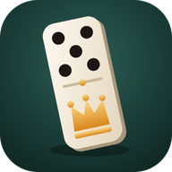

# Pedra Mestra

  

<h2 align="center"><a href="https://henriqueruher.github.io/mestre-do-domino/">▶ Jogar agora no navegador</a></h2>

https://henriqueruher.github.io/mestre-do-domino/

Dominó clássico numa mesa 3D de bar, para celular. Jogue solo, treine vendo o professor explicar cada lance ou assista uma partida corrida.

Criado por **Henrique Ruher**.

## Baixar o app (grátis) e receber atualizações automáticas

Abra o link acima e toque em **Baixar o app** no menu do jogo.

- **Android e computador (Chrome/Edge):** o botão abre a instalação direto.
- **iPhone (Safari):** o botão mostra o passo a passo: *Compartilhar* → *Adicionar à Tela de Início*.

Depois de instalado, o app abre em tela cheia, funciona sem internet e **se atualiza sozinho**: ele procura versões novas ao abrir e enquanto está em uso. Se você estiver no menu, a atualização entra na hora; no meio de uma partida, aparece um aviso com o botão *Atualizar*.

**Baixar os arquivos:** [pedra-mestra.zip](https://github.com/HenriqueRuher/mestre-do-domino/archive/refs/heads/main.zip). Para rodar no computador, sirva a pasta por HTTP (`python -m http.server 8000`) e abra http://localhost:8000.

## Música

Duas músicas de fundo tocam em sequência a partir do primeiro toque na tela. A engrenagem no canto do menu abre as **Configurações**, com o volume (padrão 40%, guardado no aparelho) e o botão para trocar de música.

## Modos

| Modo | O que acontece |
|---|---|
| **Jogar solo** | Você contra o computador. O botão *Dica* mostra a melhor jogada. |
| **Treino** | O professor joga a sua mão e explica cada lance com pausa para leitura (dois motivos e por que não a outra opção). |
| **Assistir** | Partida corrida: cada jogador "fala" a jogada num balão curto. Toque em *Por quê?* para a explicação completa. |

Cada modo pode ser jogado em:

- **Mano a mano (1×1):** 7 pedras cada, 14 no dorme. Sem jogada, compra até encaixar.
- **Duplas (2×2):** você (Sul) e Norte contra Leste e Oeste. Sem compra e sem conversa: só a jogada comunica.

## A turma da mesa

- **Seu Tião** (Norte, seu parceiro nas duplas e seu rival no 1×1): aposentado da estiva, 40 anos de mesa. Boina, bigodão branco e uma paixão por carroças.
- **Marreta** (Leste): dono de oficina, bate a pedra na mesa com força e odeia passar a vez.
- **Dona Neide** (Oeste): contadora aposentada, conta cada pedra que sai e nunca esquece um passe.

Personagens em estilo cartum (sombra chapada e contorno de tinta), cada um com suas falas.

## A mesa

Vista da sua cadeira: sua mão em pé na sua frente, as pedras dos adversários na borda da mesa e os jogadores desfocados ao fundo, num bar com spot de luz sobre a mesa, balcão com garrafas, letreiros neon, copo de cerveja, cinzeiro com cigarro aceso e um bloco com o placar da partida.

## Regras (dominó clássico)

- 28 pedras (0|0 a 6|6). Cada número aparece em 7 pedras.
- Primeira rodada: abre quem tem a carroça de 6 (no 1×1, a maior carroça na mão; sem carroça, a pedra mais pesada). Depois, sai quem venceu a rodada anterior.
- Batida: quem fica sem pedras marca a soma das mãos do lado adversário.
- Jogo trancado: vence o lado com menos pontos na mão e marca os pontos do lado perdedor. Empate: ninguém marca.
- Partida até 100 pontos.

## Como o professor decide

Cada jogada é avaliada só com o que aquele jogador poderia saber (a própria mão, a mesa e quem passou ou comprou), pesando:

1. **Bloqueio e contagem:** probabilidade de o próximo adversário não ter as novas pontas.
2. **Leitura:** quem passou ou comprou não tem aqueles números.
3. **Controle:** ficar com pedras que encaixam nas pontas.
4. **Carroças:** jogar cedo.
5. **Peso:** descartar pedras pesadas.
6. **Parceria:** não travar o parceiro, devolver os números que ele abre e fechar os que o rival abre.
7. **Tranca:** trancar só quando seu lado tem menos pontos.

## Arquivos

- `index.html` — página, estilos, menu e HUD
- `engine.js` — regras e o professor (sem dependências; roda também em Node)
- `app.js` — mesa 3D, balões e folhas
- `vendor/` — Three.js r160 (incluído para funcionar offline)
- `musicas/` — trilha de fundo
- `sw.js`, `manifest.webmanifest`, `icon*` — instalação como app e atualização automática (ao publicar, aumente `VERSION` em `sw.js` e `APP_VERSION` em `app.js`)
